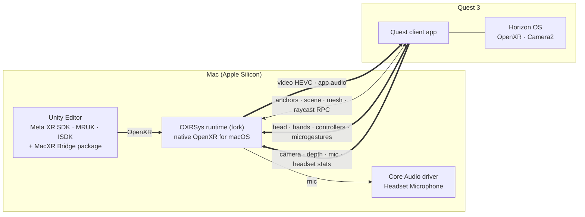

# MacXR Bridge

**Quest Link for the Mac, plus tools Quest Link doesn't have.**

Press Play in Unity on an Apple Silicon Mac and your app runs on a Meta Quest 3 with real head and hand tracking,
passthrough, your real room, the headset camera and depth. Then record that session once and keep testing it in Play
Mode with the headset sitting on your desk.

> MacXR Bridge is an independent project. It is not affiliated with, sponsored or endorsed by Meta Platforms, Inc.
> Meta, Meta Quest, Quest Link and Air Link are trademarks of Meta Platforms, Inc., used here only to describe
> compatibility. Built on [OXRSys](https://github.com/demonixis/oxrsys) by Yannick Comte and contributors (MPL-2.0).

## Why

Quest Link, Meta's way to run Unity Play Mode on a headset, only works on Windows. On a Mac, the Meta XR Simulator
gives you a synthetic room, but not your own room or the headset camera.

MacXR Bridge has three parts. A native OpenXR runtime for macOS (a fork of OXRSys) streams the Editor to a small app on
the Quest. A Unity package adds the Editor tools. A Core Audio driver turns the headset microphone into a Mac input.
The Meta XR SDK runs **unchanged** in the Editor: OVRPlugin, MRUK and the Interaction SDK see a Quest, just as they
would over Link.

## What it does that Quest Link doesn't

| | Quest Link (Windows) | MacXR Bridge |
|---|---|---|
| Runs on a Mac | No, Windows only | **Yes**, Apple Silicon |
| Record a real session (camera, depth, room, head, hands, microgestures) and replay it in Play Mode **without the headset** | No | **Yes**, with a timeline: pause, seek, frame step, 0.25×–2× |
| Perception regression tests from recorded sessions: expected classes, where labels must land (cm tolerance), forbidden classes. JUnit report, command line | No | **Yes**, deterministic (lockstep with the detector) |
| Mixed reality video from the Editor: real camera + your app rendered from the camera's exact pose + app audio + your voice → MP4 | No (passthrough doesn't show in the Game view) | **Yes** |
| Live mixed reality spectator for a browser, phone, TV or OBS on your network | Compositor mirror on the PC monitor (eye view) | **Yes**, MJPEG stream + Editor window |
| In-headset perception debug view: a ray per detection (green = landed, red = missed), live depth points | No | **Yes** |
| Drive the Editor from scripts or AI coding agents (Play, menus, room, depth, recording, tests…) | No | **Yes**, file-based command bridge |
| Open source runtime and wire protocol you can extend | No | **Yes** |

Details, sources and a comparison with the Meta XR Simulator: [docs/beyond-quest-link.md](docs/beyond-quest-link.md).

## Everything Quest Link gives you in Play Mode, on a Mac

| Feature | How it works here |
|---|---|
| Head and hand tracking, controllers, pinch and aim | Per-joint hand rotations, `XR_FB_hand_tracking_aim`/`_mesh`, so the Interaction SDK works as on the headset |
| Passthrough | Official `XR_FB_passthrough` layer controlled by your app (opacity, edge color) |
| Spatial anchors | Create, save, load and erase; saved anchors persist on the headset (`XR_FB_spatial_entity*`, `XR_META_spatial_entity_persistence`) |
| Your real room (Scene / MRUK) | Walls, floor, furniture with semantic labels and the global mesh; launch Space Setup from the Editor |
| Passthrough Camera API | The real Quest camera, 1280×960 at 30 fps, arrives in MRUK's `PassthroughCameraAccess` with its intrinsics and a calibrated pose |
| Environment depth and raycasts | Live depth map from the headset; `EnvironmentRaycastManager` works in the Editor (`XR_META_environment_raycast`) |
| Microgestures | `XR_META_hand_tracking_microgestures` (swipes and thumb tap) |
| Headset audio | The app's sound plays in the Quest |
| Headset microphone | A Mac audio device, "Headset Microphone (MacXR Bridge)", the default input while your app runs |
| USB and Wi-Fi | Everything above also works over Wi-Fi (Air Link style); USB is used whenever the cable is there |
| Display refresh rate, color space, passthrough preferences | `XR_FB_display_refresh_rate`, `XR_FB_color_space`, `XR_META_passthrough_preferences` |

Every feature, how to use it and its limits: [docs/features.md](docs/features.md).

## Quick start

You need an Apple Silicon Mac with macOS 14 or newer, Xcode, Homebrew, Java 17, the Android SDK, Unity 6000.0 with
Meta XR Core SDK and MRUK 207, and a Quest 3 in developer mode. The prerequisite check below tells you exactly what's
missing.

```bash
git clone https://github.com/edsonsims/macxr-bridge.git
cd macxr-bridge
zsh scripts/00-check-prereqs.sh                          # read-only: lists what's missing and how to get it
zsh scripts/install.sh                                   # runtime, Quest app, OpenXR registration, microphone, ffmpeg
zsh scripts/60-unity-add-package.sh /path/to/YourUnityProject
```

Keep the Quest on the USB cable during the install and accept "Allow USB debugging" with **Always allow from this
computer** ticked. `install.sh` asks for your Mac password once, to install the microphone driver.

Then:

1. Quit and reopen Unity Hub and Unity, so they pick up the new OpenXR runtime.
2. In Unity, open **Window ▸ MacXR Bridge ▸ Setup & Diagnostics** and fix anything that isn't green. It can
   configure the project's XR settings for you.
3. On the Quest, open **Library ▸ Unknown Sources ▸ OXRSys**. It waits for the Mac.
4. Press **Play**. Your app shows up in the headset.

**Window ▸ MacXR Bridge ▸ Panel** has every tool: status, microphone, camera and depth, the debug view, mixed reality
video and sessions. The full walkthrough is in [docs/getting-started.md](docs/getting-started.md).

## Documentation

| Doc | What's in it |
|---|---|
| [Getting started](docs/getting-started.md) | Requirements, install, first Play, configuration, updating, uninstalling |
| [Features](docs/features.md) | Every feature in detail, with how to use it and its limits |
| [Beyond Quest Link](docs/beyond-quest-link.md) | What MacXR Bridge adds, compared with Quest Link and the Meta XR Simulator |
| [Sessions and tests](docs/sessions-and-tests.md) | Record, replay, timeline, perception tests, CI |
| [Connect your app](docs/connect-your-app.md) | What works with no code, and the optional `BridgeHooks` |
| [Commands and automation](docs/commands.md) | Every Editor command, the scripts, the task runner |
| [Architecture](docs/architecture.md) | Components, channels and ports, OpenXR extensions, the native API |
| [Troubleshooting](docs/troubleshooting.md) | Common problems and fixes |
| [Development log](docs/development-log.md) | How it was built, step by step, with measured results |

## How it works



The Mac has no tracking of its own, so everything spatial is proxied: when your app creates an anchor or loads the
room, the runtime sends the call to the Quest app, which runs it on the headset's own OpenXR and returns the result.
More in [docs/architecture.md](docs/architecture.md).

Measured on a Quest 3 over USB: 72 Hz, 32–40 Mbps HEVC, about 11 ms from frame to headset. Over Wi-Fi: about
10 Mbps and 21 ms.

## Limits

- Apple Silicon only. Tested with a Quest 3, Unity 6000.0.85f2, Meta XR SDK 207 and the OpenXR plug-in 1.15.
- A development tool, not a way to play PC VR games.
- No eye tracking or face tracking (Quest Link offers them for headsets that have the sensors).
- Passthrough geometry (projected surfaces) is not supported. Refresh-rate requests are accepted but not forwarded.
- Unity on macOS barely renders while it's in the background: keep the Editor in front with the Game view visible.
- When the headset comes off your head, the Quest app pauses and the connection drops (as with Link).

## Security

- The Editor command bridge runs commands written to `<project>/.macxr/cmd/`, including shell commands (`sh`,
  `shbg`). Anything that can write to your project folder can use it.
- The spectator stream and the Wi-Fi channels accept connections from your local network without authentication. Use
  them on a network you trust.

## Repository layout

| Path | What |
|---|---|
| `oxrsys/` | The macOS runtime and the Quest client app: OXRSys (imported at upstream commit `a87f56f`) with the MacXR Bridge changes on top (MPL-2.0) |
| `unity-package/com.macxrbridge.xr/` | The Unity package: Editor windows, commands, recording, sessions, tests |
| `mic-driver/` | The Core Audio driver for the headset microphone |
| `scripts/` | Install, build, reconnect and check scripts, plus a task runner for automation |
| `tools/align-camera-depth.py` | Checks camera/depth alignment from saved frames |
| `unity-tools/` | Room JSON exporter for a headset build (fallback from before the live room worked) |
| `docs/` | The documentation above |

## Credits and license

- Runtime and Quest client: [OXRSys](https://github.com/demonixis/oxrsys) by Yannick Comte and contributors, extended
  here. MPL-2.0: modified files stay MPL-2.0 and their source must stay available when distributed.
- Unity package, microphone driver, scripts and docs: MIT, see [LICENSE](LICENSE).
- Made by Edson Henrique while building Lumi, a mixed reality language app, for the
  [Meta VR Start Developer Competition 2026](https://start-developer-competition-26.devpost.com/).
