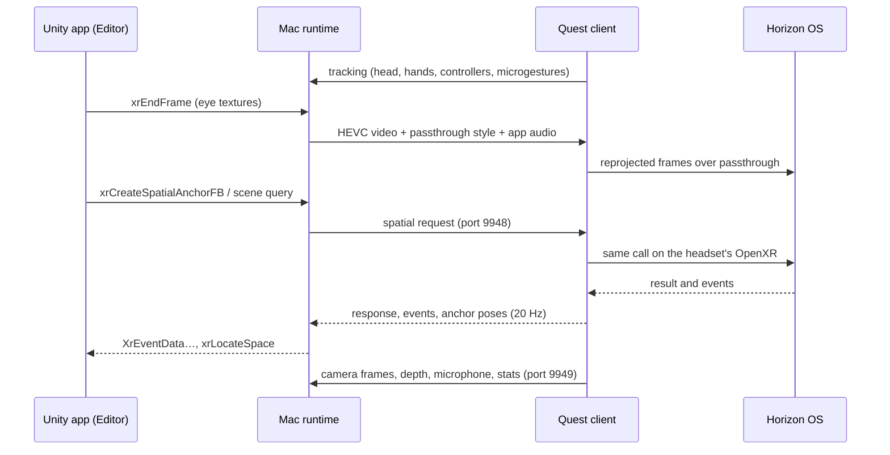

# Architecture

MacXR Bridge has four parts:

| Part | Where | Language | What it does |
|---|---|---|---|
| macOS OpenXR runtime | `oxrsys/runtime/` | C++20, Objective-C++ | The OpenXR runtime Unity loads. Encodes the app's frames (VideoToolbox HEVC), receives tracking, proxies spatial calls, receives camera, depth and microphone |
| Quest client app | `oxrsys/clients/android-vr/` | C++, Java (NDK) | Decodes and shows the frames with reprojection, sends tracking, runs spatial calls on the headset's own OpenXR, captures camera, depth and microphone, plays the app's audio |
| Unity package | `unity-package/com.macxrbridge.xr/` | C# | Editor windows and commands, camera feed into MRUK, raycast fallbacks, recording, spectator, sessions and tests |
| Microphone driver | `mic-driver/` | C (AudioServerPlugIn) | The "Headset Microphone (MacXR Bridge)" Core Audio input device |

The runtime and the Quest app are a fork of [OXRSys](https://github.com/demonixis/oxrsys), imported into `oxrsys/`
(see [Working with upstream OXRSys](#working-with-upstream-oxrsys)). OXRSys already streamed OpenXR apps from macOS to a Quest with head tracking, hands and passthrough. The fork adds
what the Meta XR SDK needs for mixed reality development, and the tools.

## Data flow



## Channels and ports

Over USB, every TCP port goes through `adb reverse`, so the Quest connects to `localhost`. Over Wi-Fi, the client
connects to the Mac's address; the spatial and camera listeners accept peers from private address ranges only (10/8,
172.16/12, 192.168/16, 169.254/16 and loopback).

| Port | Channel | Direction | Content |
|---|---|---|---|
| 9943 (UDP) | Discovery | Mac → network | Server announcements (Wi-Fi) |
| 9944 | Video | Mac → Quest | HEVC (or H.264) stereo frames |
| 9945 | Tracking | Quest → Mac | `TrackingPacket`: head, controllers, buttons, 26 hand joints with per-joint rotations, microgesture bits |
| 9946 | Control | both | Session control, capabilities, passthrough style |
| 9948 | Spatial | both | RPC proxy for anchors, persistence, scene, scene capture, mesh |
| 9949 | Camera | both | Quest → Mac: camera frames (JPEG + intrinsics + pose), depth, microphone, headset stats. Mac → Quest: app audio, camera config |

Port 9947 is upstream's reserved audio port; MacXR Bridge carries audio on the camera channel instead.

### Tracking

Upstream OXRSys sent one rotation per hand. The fork adds each joint's rotation (26 joints, four int16 each), flagged
with `TRACKING_FLAG_HAND_JOINT_ROTATIONS_VALID`, so older clients still work. Microgestures use spare bits (22–31) of
`buttonState`, each held for about 120 ms after the gesture.

### Spatial proxy

The Mac has no tracking or scene of its own, so every spatial function becomes a message:
`MsgHeader {version, kind, op, requestId, payloadSize}` plus a plain struct. Requests are synchronous (4 s timeout,
10 s for meshes). Asynchronous completions (`XrEventData…CompleteFB/META`) come back as events, delivered from
`xrPollEvent` on the app thread. Each remote space's pose streams at 20 Hz in the client's STAGE space (the runtime's
world frame). The client checks every space id it receives, so stale ids never reach Meta's runtime, and destroys its
spaces when it disconnects. Results are cached where the spec allows: UUIDs and components (immutable), component
status (500 ms), meshes (3 s, for the two-call idiom).

### Camera channel

Messages (`common/CameraProtocol.h`): `Hello`, `Frame` (JPEG, 1280×960, 30 fps, with intrinsics and head pose),
`Config`, `Depth` (one eye of `XR_META_environment_depth`, 320×320, uint16, 5 Hz, with near/far, view pose and FOV),
`Audio` (the app's mix, PCM s16, 20 ms), `Mic` (headset microphone, PCM s16, 48 kHz mono, 20 ms) and `Stats` (battery,
temperature, frame rates, about once a second).

## OpenXR extensions

The runtime advertises these extensions (upstream ones and the fork's additions):

| Area | Extensions |
|---|---|
| Graphics | `XR_KHR_metal_enable`, `XR_KHR_vulkan_enable`, `XR_KHR_vulkan_enable2`, `XR_KHR_composition_layer_cylinder`, `XR_KHR_convert_timespec_time` |
| Spaces and system | `XR_EXT_local_floor`, `XR_META_headset_id`, `XR_FB_display_refresh_rate`, `XR_FB_color_space`, `XR_EXT_debug_utils`, `XR_EXT_conformance_automation` |
| Input | `XR_EXT_hand_tracking`, `XR_EXT_hand_interaction`, `XR_FB_hand_tracking_aim`, `XR_FB_hand_tracking_mesh`, `XR_META_hand_tracking_microgestures`, `XR_META_touch_controller_plus` |
| Passthrough | `XR_FB_passthrough`, `XR_META_passthrough_preferences` |
| Anchors and scene | `XR_FB_spatial_entity`, `XR_FB_spatial_entity_storage`, `XR_FB_spatial_entity_query`, `XR_FB_spatial_entity_container`, `XR_META_spatial_entity_persistence`, `XR_META_spatial_entity_discovery`, `XR_FB_scene`, `XR_FB_scene_capture`, `XR_META_spatial_entity_mesh` |
| Depth | `XR_META_environment_raycast`, `XR_EXT_future` |

## Making OVRPlugin accept a non-Meta runtime

These fixes in the fork let the Meta XR SDK (OVRPlugin 1.207) start on the Mac runtime at all:

1. Accept any OpenXR 1.1 patch version (OVRPlugin asks for 1.1.61).
2. Advertise and fill in `XR_META_headset_id` (`MetaXRFeature` only turns on with it).
3. Report `runtimeName = "OXRSys Runtime for Meta Quest"` and `systemName = "Meta Quest 3"` (OVRPlugin rejects
   runtimes named as non-Meta).
4. Return a 3×3 m `STAGE` before the guardian arrives, instead of `XR_SPACE_BOUNDS_UNAVAILABLE`.
5. Advertise `XR_EXT_local_floor`.
6. Put the default `LOCAL` space at eye height (0, 1.6, 0). With `LOCAL` on the floor, Unity read
   `LOCAL_FLOOR − LOCAL = 0` as "unknown floor" and recreated its app space every frame, so `xrEndFrame` pointed at a
   destroyed space and no frame was ever shown.
7. Fill in hand scale and aim state, so the Interaction SDK considers the hands connected.
8. Return semantic label sizes without the terminator, as the Quest runtime does (MRUK builds
   `std::string(buffer, count)`).

The [development log](development-log.md) tells the story of each one, with the logs that led to it.

## Native API for the Unity package

The runtime dylib exports a small C API that the package calls with `dlsym` on the already loaded runtime (loading a
second copy would give it a separate state):

| Function | Use |
|---|---|
| `oxrsys_camera_connected`, `oxrsys_camera_get_latest` | Latest camera frame (RGBA) with intrinsics and world pose |
| `oxrsys_depth_get_latest`, `oxrsys_depth_inject`, `oxrsys_depth_replay_mode` | Latest depth frame; injection for replays |
| `oxrsys_audio_push` | The app's audio mix to the headset |
| `oxrsys_mic_pull`, `oxrsys_mic_status`, `oxrsys_mic_set_default` | Headset microphone samples (2 s ring), status, default input |
| `oxrsys_client_stats_get` | Headset battery, temperature, frame rates |
| `oxrsys_tracking_record_start/stop`, `oxrsys_tracking_replay_start/stop/clock` | The tracking tape for sessions |
| `oxrsys_local_reference_get/set/from_tape` | The LOCAL reference, for hermetic replays |
| `oxrsys_runtime_status_path` | Where the runtime writes its live status JSON |

## Files on your Mac

| Path | What |
|---|---|
| `oxrsys/build/macos-arm64/runtime/` | The runtime (`liboxrsys-runtime.dylib`, `oxrsys-runtime.json`) |
| `~/.config/openxr/1/active_runtime.json` | Link to the active runtime's manifest |
| `~/Library/LaunchAgents/net.demonixis.oxrsys.runtime-env.plist` | Sets `XR_RUNTIME_JSON` for apps opened from the Dock or Unity Hub |
| `~/Library/Application Support/OXRSys/oxrsys-runtime.toml` | Streaming settings |
| `~/Library/Application Support/OXRSys/oxrsys-runtime.log` | Runtime log |
| `/Library/Audio/Plug-Ins/HAL/MacXRBridgeMic.driver` | Microphone driver |
| `<project>/.macxr/` | Command bridge, Console mirror, status, debug images |
| `<project>/Recordings/`, `Sessions/`, `TestResults/` | Videos, sessions, test reports |

## Working with upstream OXRSys

`oxrsys/` starts from an import of OXRSys at upstream commit `a87f56f` (just after the 1.3.0 release); the MacXR Bridge
changes are the commits on top of it in this repository.

Bring in later upstream changes by applying the upstream diff since the last synced commit:

```bash
git fetch https://github.com/demonixis/oxrsys.git main
git diff a87f56f FETCH_HEAD | git apply -3 --directory=oxrsys
```

Resolve any conflicts, commit, and put the new upstream commit in the message: it's the starting point of the next
sync.

Send a fix back upstream as patches, then open a pull request from your own fork of OXRSys:

```bash
git format-patch --relative=oxrsys -o /tmp/oxrsys-patches <first-commit>^..<last-commit> -- oxrsys
# in a clone of your fork of demonixis/oxrsys:
git am /tmp/oxrsys-patches/*.patch
```
