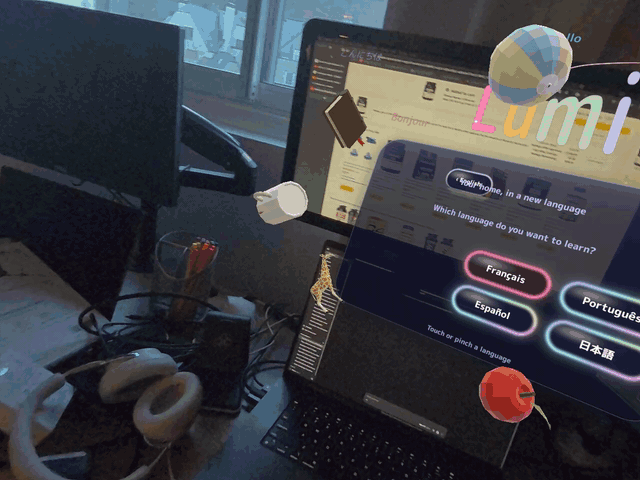
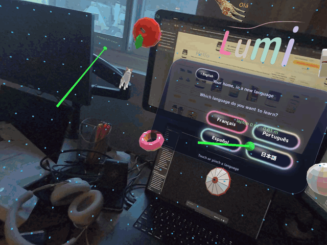

# Features

Everything below works in Unity Play Mode on the Mac with a Quest 3, with the Meta XR SDK running unchanged. Where a
feature has an Editor command, it's listed; the full list is in [commands.md](commands.md). Every command is also a
button in **Window ▸ MacXR Bridge ▸ Panel**.

- [Tracking and input](#tracking-and-input)
- [Passthrough](#passthrough)
- [Spatial anchors](#spatial-anchors)
- [Your real room (Scene and MRUK)](#your-real-room-scene-and-mruk)
- [Passthrough Camera API](#passthrough-camera-api)
- [Environment depth and raycasts](#environment-depth-and-raycasts)
- [Headset audio and microphone](#headset-audio-and-microphone)
- [Connection: USB and Wi-Fi](#connection-usb-and-wi-fi)
- [Smaller extensions](#smaller-extensions)
- [Developer tools](#developer-tools)

## Tracking and input

- **Head**: the Quest streams its pose to the runtime, which predicts it forward to cover the network latency.
  `LOCAL`, `LOCAL_FLOOR` (`XR_EXT_local_floor`) and `STAGE` reference spaces work as on the headset.
- **Hands**: `XR_EXT_hand_tracking` with all 26 joints, each with its own rotation. That's an extension of the
  OXRSys protocol: upstream sent one rotation per hand, which twisted the fingers in the Interaction SDK.
  `XR_FB_hand_tracking_aim` provides pinch strength and the aim pose, and `XR_FB_hand_tracking_mesh` provides the hand
  scale, so the Interaction SDK treats the hands as connected: pinch, poke, grab and hand rays all work.
- **Controllers**: Touch and Touch Plus (`XR_META_touch_controller_plus`).
- **Microgestures**: `XR_META_hand_tracking_microgestures`: swipe left, right, forward and back, and thumb tap. They
  reach `OVRPlugin.GetHandTrackingState().Microgesture` as on the headset. Command: `micro` (status and counts).

## Passthrough

- The official `XR_FB_passthrough` path: `OVRManager`'s passthrough and `OVRPassthroughLayer` work unchanged.
- **Your app decides**: while it has an active passthrough layer, the Quest shows passthrough under the streamed frame
  with the layer's opacity and edge color; when it turns the layer off, the passthrough goes away too.
- Transparent pixels in your app show the real world (real alpha, not a color key).
- `XR_META_passthrough_preferences` is answered (no "start in passthrough" preference).
- Not supported: passthrough geometry instances (projected surfaces) return `XR_ERROR_FEATURE_UNSUPPORTED`.
- The Game view on the Mac shows your app over black, because the passthrough only exists in the headset. For a
  composite on the Mac, use the [spectator](#mixed-reality-video-and-spectator).

## Spatial anchors

- `OVRSpatialAnchor` and the underlying `XR_FB_spatial_entity`, `_storage`, `_query` and `_container`, plus
  `XR_META_spatial_entity_persistence` and `_discovery`: create, save, load by UUID and erase.
- Anchors are real headset anchors: the Mac forwards each call to the Quest app, which runs it on the headset's own
  OpenXR runtime and streams the anchors' poses back 20 times a second. Saved anchors persist on the headset and load again in later Play
  sessions.
- Limit: when the Quest app pauses (headset taken off), it drops its connection and its spaces. Anchors already in
  Unity become orphaned: load them again by UUID, as you would after a Quest Link drop.
- Commands: `anchor x y z` (creates a test anchor), `anchors`, `anchor-save all|<name>`, `anchor-load <uuid>[,<uuid>]`,
  `anchor-erase <name>`.

## Your real room (Scene and MRUK)

- `MRUK.LoadSceneFromDevice()` loads the room you scanned with Space Setup on the headset: walls, floor, ceiling,
  windows and furniture with their semantic labels (`TABLE`, `BED`, `SCREEN`, `WALL_ART`…), plus the global mesh
  (`XR_META_spatial_entity_mesh`).
- `XR_FB_scene_capture`: launch Space Setup on the headset from the Editor (`room-capture`).
- Commands: `room-load`, `room` (describes the room), `room-draw` (draws planes and volumes), `room-mesh`,
  `room-fetch [all|anchors|semantic]` (raw anchors), `room-capture`.
- Space Setup must have been run on the headset first; otherwise MRUK reports `NoRoomsFound`.

## Passthrough Camera API

- The Quest app opens the passthrough camera with Camera2 (the left camera) at **1280×960, 30 fps**, and sends each
  frame (JPEG) with the camera's intrinsics and the head pose at the moment of capture.
- In Play, as soon as the camera connects, the package feeds it into MRUK's **`PassthroughCameraAccess`**: texture,
  `IsPlaying`, resolution, intrinsics and camera pose. Code that reads `PassthroughCameraAccess`, such as Meta's AI
  Building Blocks `ObjectDetectionAgent`, works with no changes. Object detection runs on the Mac's GPU. Turn the
  automatic feed off with the EditorPref `MacXRBridge.AutoCamera = false`.
- **Calibrated camera pose**: aligning the camera image with the depth map showed the camera sits about 2° down, 3° to
  the right and 2° rolled relative to the head (±1°). The pose computed from Camera2's `LENS_POSE_ROTATION` was about 11°
  off, because that rotation is relative to the IMU rather than the head: about 20 cm of error on a label 1.5 m away.
  The package uses the calibrated values; `camera-show lens=camera2` switches back to compare.
  `tools/align-camera-depth.py` reproduces the measurement.
- This is a relay of our own. Meta's Editor path for the camera (`XR_METAX1_passthrough_camera`) is experimental and
  has no public headers.
- The camera survives the headset going to sleep: the Quest app reopens it when it resumes.
- Commands: `camera [file.png]` (saves the latest frame), `camera-show [detect] [noquad] [thr=0.3] [fixed] [test] [off]`
  (shows the feed on a quad in front of you, drives detection, lowers the confidence threshold for the session),
  `detect-status`, `yolo-test`, `agent-test`.

## Environment depth and raycasts

- The Quest app reads the environment depth (`XR_META_environment_depth`, with hand removal) five times a second, at
  320×320, and sends it with its pose, field of view and near/far planes.
- The runtime answers **`XR_META_environment_raycast`** (with `XR_EXT_future`) on the Mac from that depth, so MRUK's
  **`EnvironmentRaycastManager` reports `IsSupported = true` and `IsReady = true` in the Editor**, and raycasts land on
  real surfaces.
- `BridgeRaycast` offers a fallback chain for your own code: depth, then the MRUK room, then physics, then a fixed
  distance.
- Command: `depth` (saves `.macxr/depth.png` and casts a test ray from your head).
- Not provided in the Editor: the depth texture for occlusion shaders (`EnvironmentDepthManager`). Raycasts work;
  depth-based occlusion still needs a build.

## Headset audio and microphone

- **App audio in the headset**: a tap on the `AudioListener` (`BridgeAudioTap`, added automatically in Play) sends
  Unity's final mix to the Quest in 20 ms chunks at 48 kHz, played with a 60 ms buffer. The Mac is muted meanwhile;
  `audio mac on` plays on both. `audio beep` plays a test tone.
- **Headset microphone on the Mac**: the Quest app records the headset microphone (48 kHz mono, voice preset) and the
  runtime feeds it to a Core Audio device, **"Headset Microphone (MacXR Bridge)"**, which becomes the Mac's default
  input while your app runs and is restored afterwards. Unity's `Microphone` class records your voice from the
  headset, and so can any other Mac app. Set `OXRSYS_MIC_DEFAULT=0` to keep your current default input.
- Commands: `mic` (status and level), `mic test` (records 3 seconds), `mic default on|off`.

## Connection: USB and Wi-Fi

- **USB** (preferred): channels go through `adb reverse`. The Quest app tries USB first whenever it reconnects.
- **Wi-Fi**: Mac and Quest on the same local network. The video, tracking, spatial and camera channels all work, so the
  room, anchors, camera, depth, audio and microphone work too. The video bitrate adapts to the network.
- Measured on a Quest 3:

  | | Bitrate | Frame to headset | Repeated frames |
  |---|---|---|---|
  | USB | 32–40 Mbps HEVC | about 11 ms | 1–3 per second |
  | Wi-Fi | about 10 Mbps | about 21 ms | 18–20 per second |

- The Quest app only uses USB if Unity is already in Play when it connects; otherwise it connects over Wi-Fi.
  `scripts/80-reconnect-quest.sh` restarts it over USB.
- Testing with nobody wearing the headset: the proximity sensor pauses the Quest app. `scripts/prox-keepalive.sh`
  keeps the sensor "covered" while it runs.

## Smaller extensions

| Extension | Behavior |
|---|---|
| `XR_FB_display_refresh_rate` | Reports 72, 80, 90 and 120 Hz and the current rate; requests are recorded, not forwarded to the headset |
| `XR_FB_color_space` | Reports Rec.2020; the app's choice is accepted |
| `XR_META_headset_id` | Reports a Quest 3, so `MetaXRFeature` and OVRPlugin turn on |
| `XR_META_passthrough_preferences` | Answered (no "start in passthrough") |

## Developer tools

These go beyond what Quest Link offers; [beyond-quest-link.md](beyond-quest-link.md) compares them.

### Panel

**Window ▸ MacXR Bridge ▸ Panel** has every tool as a button:
- **Status**: the same numbers as the HUD below, a button to reconnect the Quest and the headset HUD switch.
- **Headset microphone**: device, level and a 3-second test.
- **Real world**: camera, depth, room, the headset debug view.
- **Mixed reality video**: record and stop.
- **Sessions**: record, replay with a timeline, baseline and test.

### Mixed reality video and spectator

- **Recording** (`record start [name] [nomic]`, `record stop`): each real camera frame is the background, and your app
  is rendered on top by a virtual camera at the real camera's pose and with its intrinsics (an off-axis projection
  through the principal point), so virtual objects sit exactly where they appear in the headset. The app's audio and
  your voice (from the headset microphone) are mixed in. Output: `<project>/Recordings/<name>-<date>.mp4`, 1280×960 at
  30 fps, hardware H.264 at 16 Mb/s.
- **Spectator window**: **Window ▸ MacXR Bridge ▸ Spectator (Mixed Reality)** shows the same composite live in the
  Editor.
- **Network stream** (`stream on [port]`, `stream off`): the composite as MJPEG at up to 15 fps on
  `http://<mac-ip>:8765/`, with `/stream` and `/snapshot.jpg`. Open it in a browser, on a phone or TV, or as an OBS
  Browser Source. No authentication: trusted networks only.

### Headset debug view

`debug on|off|depth|nodepth`: draws into the scene, so you see it in the headset, one ray per detection box. A green ray
ends where the label landed; a red one shows a detection that hit nothing, labeled with class, score and distance.
With `depth`, it also draws a grid of points where the depth sensor sees surfaces (about 300–430 points, twice a
second). It disappears when you exit Play.

### Performance HUD

`hud on|off`: a head-locked panel in the headset with the transport, refresh rate, bitrate, codec, latency (Mac and
Quest), encode and decode times, the headset's fps, video fps, battery and temperature, Unity's fps on the Mac, camera
fps, depth rate and microphone level. Quest Link has its own HUD (the Oculus Debug Tool); this one adds the camera,
depth and microphone channels and the Quest's battery and temperature.

### Sessions and perception tests

Record camera, depth, room and the full tracking stream once with the headset, then replay it in Play Mode without the
headset, with a timeline, and turn it into automated perception tests. See [sessions-and-tests.md](sessions-and-tests.md).

### Command bridge

Every tool is also a text command that scripts and AI coding agents can send to the Editor through files. See
[commands.md](commands.md).
